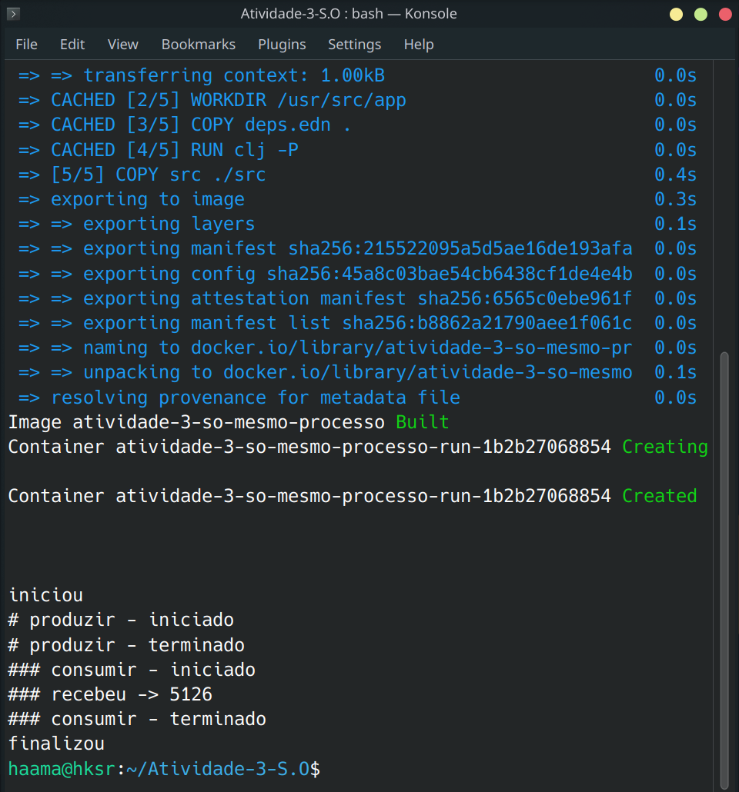
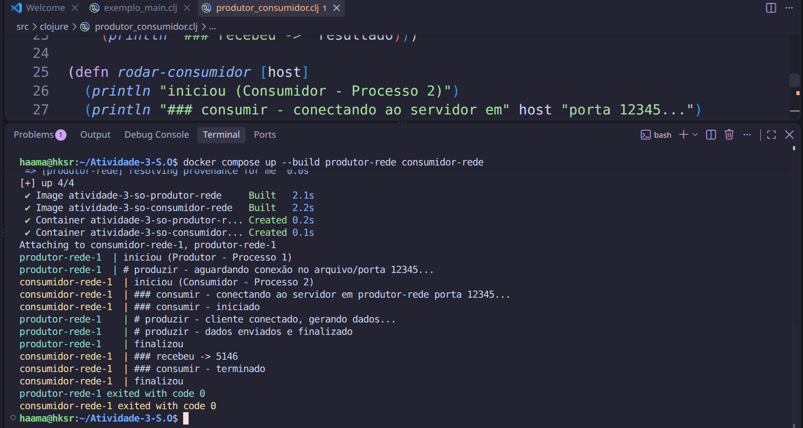

# Relatório sobre implementação de comunicação entre tarefas em Clojure

## Introdução

Este relato faz parte do processo avaliativo da disciplina de sistemas operacionais no curso superior em análise e desenvolvimento de sistemas, ofertado na Diretoria acadêmica de gestão e tecnologia da informação no campus natal-central do instituto federal de educação, ciência e tecnologia do rio grande do norte.

Tem como objetivo principal relatar as implementações de comunicação entre tarefas na linguagem Clojure.

O grupo de trabalho foi formado por Geovanna Araújo e Haama Kethelen.

## Comunicação entre tarefas em Clojure

### Informações gerais

#### Qual o objetivo de comunicação entre tarefas?

Dividir uma aplicação em várias tarefas traz vantagens como:

- **Atender vários usuários simultâneos:** evita esperas longas para o usuário;
- **Uso de computadores multiprocessador:** a divisão de tarefas aumenta a velocidade de execução de uma aplicação;
- **Modularidade:** sistemas grandes e complexos têm suas tarefas divididas em módulos para melhor organização;
- **Construção de aplicações interativas:** tarefas associadas à interface reagem a comandos do usuário, enquanto outras tarefas se comunicam através da rede.

Para que essas tarefas cooperem, elas precisam **trocar dados e sincronizar sua execução**. Esse é o objetivo da comunicação entre tarefas. Neste trabalho, ela é demonstrada com o modelo **produtor-consumidor**: uma tarefa gera 100 números aleatórios e outra recebe esses números e calcula a soma.

#### Por que usar Docker nesse trabalho?

- **Ambiente igual para todos:** não depende do que cada integrante tem instalado (JDK, Clojure CLI etc.);
- **Facilidade de execução e avaliação:** cada cenário é executado com um único comando;
- **Simulação de ambientes distribuídos:** contêineres diferentes, ligados pela rede do Docker Compose, simulam computadores diferentes no cenário 3.

#### Qual a configuração do Docker?

A imagem base é a oficial `clojure:temurin-17-tools-deps-alpine` (JDK 17 + Clojure CLI). O `Dockerfile` copia primeiro o `deps.edn` e baixa as dependências (`clj -P`), e só depois copia o código. Assim, alterações no código não exigem baixar as dependências de novo.

`Dockerfile`:

```dockerfile
FROM clojure:temurin-17-tools-deps-alpine

WORKDIR /usr/src/app

COPY deps.edn .
RUN clj -P

COPY src ./src
```

`deps.edn` (o `:paths` aponta para `src/clojure`, onde ficam os arquivos `.clj`):

```clojure
{:paths ["src/clojure"]
 :deps {org.clojure/clojure {:mvn/version "1.11.1"}}}
```

`docker-compose.yml` (um serviço por cenário; todos usam a mesma imagem e mudam apenas o comando):

```yaml
services:
  # Cenário 1: Linhas de execução no mesmo processo
  mesmo-processo:
    build: .
    command: clj -M -m exemplo-main

  # Cenário 2: Processos diferentes no mesmo computador
  produtor-local:
    build: .
    command: clj -M -m produtor-consumidor
    ports:
      - "12345:12345"

  # Cenário 3: Computadores diferentes em rede
  produtor-rede:
    build: .
    command: clj -M -m produtor-consumidor
    ports:
      - "12345:12345"

  consumidor-rede:
    build: .
    command: clj -M -m produtor-consumidor produtor-rede
    depends_on:
      - produtor-rede
```

O comando `clj -M -m <namespace> [argumentos]` carrega o namespace indicado e chama a função `-main` dele, repassando os argumentos.

### Comunicação entre tarefas com linhas de execução no mesmo processo

#### Resumo do código

O arquivo `src/clojure/exemplo_main.clj` define o namespace (`ns`), o gerador de dados (`produzir-dados`) e o processador de dados (`consumir-dados`). Na função `-main`, cada tarefa roda em uma thread própria criada com `future`:

- **Thread produtora:** gera os 100 números e devolve a lista como resultado do `future`;
- **Thread consumidora:** usa `@thread-produtor` para obter os dados. O `@` (deref) bloqueia a thread até o produtor terminar, e é isso que sincroniza as duas tarefas;
- **Thread principal:** aguarda o consumidor com `@thread-consumidor` antes de imprimir "finalizou".

Como as threads estão no mesmo processo, elas compartilham memória, e o dado passa de uma para outra diretamente. Os dados são imutáveis, então não há risco de condição de corrida.

```clojure
(ns exemplo-main)

(defn produzir-dados []
  (repeatedly 100 #(rand-int 111)))

(defn consumir-dados [dados]
  (let [resultado (reduce + dados)]
    (println "### recebeu ->" resultado)))

(defn -main []
  (println "iniciou")
  (let [thread-produtor (future
                          (println "# produzir - iniciado")
                          (let [dados (produzir-dados)]
                            (println "# produzir - terminado")
                            dados))
        thread-consumidor (future
                            (println "### consumir - iniciado")
                            (consumir-dados @thread-produtor)
                            (println "### consumir - terminado"))]
    @thread-consumidor)
  (println "finalizou"))
```

#### Execução

```bash
docker compose run --rm --build mesmo-processo
```

O `--build` reconstrói a imagem com o código atual, e o `--rm` remove o contêiner ao final. O serviço executa `clj -M -m exemplo-main`.

Saída do terminal:

```text
iniciou
# produzir - iniciado
# produzir - terminado
### consumir - iniciado
### recebeu -> 5126
### consumir - terminado
finalizou
```




#### Problemas na execução

**Problema 1:** A construção da imagem Docker falhou por erro no download da imagem base do Clojure, provavelmente por indisponibilidade da tag ou oscilação de rede.
**Solução:** Alterar o `FROM` do Dockerfile para `clojure:temurin-17-tools-deps-alpine`, uma tag oficial e estável. Funcionou? Parcialmente: a imagem foi construída, mas o código deu erro na última linha.

**Problema 2:** Divergência entre o nome usado no `docker-compose.yml` e o namespace chamado pelo terminal.
**Solução:** Ajustar o comando do serviço no `docker-compose.yml`. Funcionou? Não, o contêiner encerrava em silêncio logo após a criação, sem saída.

**Problema 3:** Não havia nenhuma saída, porque a função `-main` não estava sendo chamada.
**Solução:** Atualizar o `deps.edn` e o YAML, e adicionar uma chamada `(-main)` no fim do `exemplo_main.clj`. Funcionou? Sim, a saída apareceu, mas gerou o problema 4.

**Problema 4:** A saída aparecia duplicada: duas execuções seguidas, com resultados diferentes.
**Solução:** Remover o `(-main)` do fim do arquivo. Ao carregar o arquivo, o Clojure executava essa chamada, e depois o `-m exemplo-main` chamava `-main` de novo. Com o comando correto no compose (`-m exemplo-main`), a chamada no arquivo é desnecessária. Funcionou? Sim.

### Comunicação entre tarefas em processos diferentes no mesmo computador

#### Resumo do código

Processos diferentes não compartilham memória, por isso precisam de um mecanismo de comunicação entre processos (IPC). Usamos um **socket TCP**. O mesmo arquivo, `src/clojure/produtor_consumidor.clj`, contém os dois papéis, e a função `-main` decide qual executar pelo argumento:

- **Sem argumento:** roda o **produtor** (`rodar-produtor`);
- **Com um host como argumento:** roda o **consumidor** (`rodar-consumidor`), que conecta nesse host.

Produtor:

- `ServerSocket.` abre a porta TCP 12345 e `.accept` espera um cliente conectar;
- `with-open` garante que o servidor, o socket e o fluxo de saída sejam fechados automaticamente ao final, mesmo em caso de erro;
- `PrintWriter` envia texto pela conexão. Os dados são serializados com `pr-str` (a lista vira uma string no formato Clojure) e enviados em uma linha com `.println`.

Consumidor:

- `Socket.` conecta ao host e à porta do produtor;
- `BufferedReader` + `InputStreamReader` leem a resposta como texto, e `.readLine` lê a linha enviada;
- `clojure.edn/read-string` converte a string de volta em uma lista de números, que é somada por `consumir-dados`.

```clojure
(ns produtor-consumidor
  (:import [java.net ServerSocket Socket]
           [java.io PrintWriter BufferedReader InputStreamReader]))

(defn produzir-dados []
  (repeatedly 100 #(rand-int 111)))

(defn rodar-produtor []
  (println "iniciou (Produtor - Processo 1)")
  (println "# produzir - aguardando conexão no arquivo/porta 12345...")

  (with-open [server (ServerSocket. 12345)
              socket (.accept server)
              out (PrintWriter. (.getOutputStream socket) true)]
    (println "# produzir - cliente conectado, gerando dados...")
    (let [dados (produzir-dados)]
      (.println out (pr-str dados))
      (println "# produzir - dados enviados e finalizado")))
  (println "finalizou"))

(defn consumir-dados [dados]
  (let [resultado (reduce + dados)]
    (println "### recebeu ->" resultado)))

(defn rodar-consumidor [host]
  (println "iniciou (Consumidor - Processo 2)")
  (println "### consumir - conectando ao servidor em" host "porta 12345...")
  (with-open [socket (Socket. host 12345)
              in (BufferedReader. (InputStreamReader. (.getInputStream socket)))]
    (println "### consumir - iniciado")
    (let [linha (.readLine in)
          dados (clojure.edn/read-string linha)]
      (consumir-dados dados))
    (println "### consumir - terminado"))
  (println "finalizou"))

(defn -main [& args]
  (let [host (first args)]
    (if (and host (not= host "*command-line-args*"))
      (rodar-consumidor host)  ; Se recebeu o IP/host como argumento, roda o CONSUMIDOR
      (rodar-produtor))))      ; Se rodou sem argumentos, roda o PRODUTOR
```

#### Execução

Os dois processos rodam **no mesmo contêiner**, que faz o papel do "mesmo computador", e se comunicam via `localhost`. Foram usados dois terminais.

Terminal 1: abre um shell dentro de um contêiner do serviço `produtor-local` e inicia o produtor nele:

```bash
docker compose run --rm --build --name so-local --entrypoint sh produtor-local
# dentro do contêiner:
clojure -M -m produtor-consumidor
```

Terminal 2: executa o consumidor no mesmo contêiner, passando `localhost` como host:

```bash
docker exec so-local clojure -M -m produtor-consumidor localhost
```

O `--entrypoint sh` mantém o contêiner vivo pelo shell, independentemente de o produtor terminar. Assim, os dois processos podem rodar até o fim. Ao terminar, basta digitar `exit` no terminal 1.

Saída do terminal 1 (produtor):

```text
iniciou (Produtor - Processo 1)
# produzir - aguardando conexão no arquivo/porta 12345...
# produzir - cliente conectado, gerando dados...
# produzir - dados enviados e finalizado
finalizou
```

Saída do terminal 2 (consumidor):

```text
iniciou (Consumidor - Processo 2)
### consumir - conectando ao servidor em localhost porta 12345...
### consumir - iniciado
### recebeu -> 4984
### consumir - terminado
finalizou
```


#### Problemas na execução

**Problema 1:** O Clojure não executou o namespace correto, por um erro no classpath.
**Solução:** Ajustar o arquivo YAML para chamar o namespace diretamente. Funcionou? Não, o Clojure não encontrou `produtor-consumidor` nas pastas do classpath.

**Problema 2:** O classpath não refletia a estrutura de diretórios do projeto.
**Solução:** Alterar o `:paths` do `deps.edn` de `"src"` para `"src/clojure"`. Funcionou? Parcialmente: o produtor passou a funcionar, mas o consumidor não.

**Problema 3:** Os dois terminais tentavam usar a mesma porta ao mesmo tempo.
**Solução:** Executar `docker compose down` e depois `up`, e no terminal do consumidor usar `docker run --rm --network host atividade-3-so-produtor-local clj -M -m produtor-consumidor localhost`. Funcionou? Não, o conflito de porta continuou. A causa real foi identificada no problema 7.

**Problema 4:** A estrutura do código do consumidor no `produtor_consumidor.clj` não estava coerente.
**Solução:** Reorganizar o código, separando `rodar-produtor` e `rodar-consumidor` e ajustando os imports Java. Funcionou? Em partes, passou a haver problemas com o endereço.

**Problema 5:** O parâmetro `localhost` não estava sendo repassado como esperado no comando `docker compose run --rm --network host produtor-local clj -M -m produtor-consumidor localhost`.
**Solução:** Usar `docker compose run --rm -v $(pwd):/usr/src/app produtor-local clj -M -m produtor-consumidor produtor-local`. Funcionou? Não.

**Problema 6:** Nova tentativa de resolver o problema 5 com `docker compose run --rm --entrypoint "clj -M -m produtor-consumidor produtor-local" produtor-local`.
**Solução:** Nenhuma. O `--entrypoint` aceita só o executável, não o comando inteiro com argumentos. Funcionou? Não.

**Problema 7:** O consumidor nunca era executado. Havia uma chamada `(-main)` no fim do arquivo, que o Clojure executava ao carregar o arquivo, sem argumentos. Com isso, todo processo começava como **produtor** e abria a porta 12345, antes mesmo de o argumento `localhost` ser lido. Era essa a causa do conflito de portas dos problemas 3, 5 e 6.
**Solução:** Remover o `(-main)` do fim do arquivo. Funcionou? Sim.

**Problema 8:** Rodando o consumidor com `docker compose exec` dentro do contêiner do produtor, ele conectava, mas era encerrado antes de imprimir o resultado. Quando o produtor terminava, o processo principal do contêiner acabava, o contêiner parava e levava junto o processo do consumidor.
**Solução:** Iniciar o contêiner com um shell (`--entrypoint sh`) e rodar os dois processos dentro dele, conforme a seção de execução. Funcionou? Sim.

### Comunicação entre tarefas em processos diferentes em computadores diferentes

#### Resumo do código

O código é o **mesmo do cenário 2** (`src/clojure/produtor_consumidor.clj`). O que muda é o ambiente de execução:

- Produtor e consumidor rodam em **contêineres separados** (`produtor-rede` e `consumidor-rede`). Cada contêiner tem seu próprio sistema de arquivos, processos e endereço IP, simulando dois computadores;
- O Docker Compose cria uma rede para os serviços, com DNS interno. Por isso o consumidor encontra o produtor pelo **nome do serviço**, `produtor-rede`, passado como argumento no `docker-compose.yml`, em vez de um IP fixo;
- O `ServerSocket.` criado só com a porta escuta em todas as interfaces de rede do contêiner. Por isso aceita conexões vindas de outro contêiner, e não apenas de `localhost`.

#### Execução

```bash
docker compose up --build produtor-rede consumidor-rede
```

O `up` constrói as imagens, cria os contêineres, conecta-os à mesma rede e inicia os dois serviços, mostrando a saída de ambos no mesmo terminal. Ao final, `docker compose down` remove os contêineres e a rede.

Saída do terminal:

```text
Attaching to consumidor-rede-1, produtor-rede-1
produtor-rede-1    | iniciou (Produtor - Processo 1)
produtor-rede-1    | # produzir - aguardando conexão no arquivo/porta 12345...
consumidor-rede-1  | iniciou (Consumidor - Processo 2)
consumidor-rede-1  | ### consumir - conectando ao servidor em produtor-rede porta 12345...
consumidor-rede-1  | ### consumir - iniciado
produtor-rede-1    | # produzir - cliente conectado, gerando dados...
produtor-rede-1    | # produzir - dados enviados e finalizado
produtor-rede-1    | finalizou
consumidor-rede-1  | ### recebeu -> 5146
consumidor-rede-1  | ### consumir - terminado
consumidor-rede-1  | finalizou
produtor-rede-1 exited with code 0
consumidor-rede-1 exited with code 0
```




#### Problemas na execução

**Problema 1:** O serviço `consumidor-rede` subia em modo produtor, e não em modo consumidor.
**Solução:** Revisar o comando do serviço no `docker-compose.yml`. Funcionou? Não, o modo consumidor continuava sem ser executado.

**Problema 2:** Nova tentativa de resolver o problema 1.
**Solução:** Escrever o `command` do serviço em formato de array JSON. Funcionou? Não, o Docker Compose acusou erro de parser no YAML.

**Problema 3:** O erro de parser vinha da sintaxe do YAML (indentação ou aspas na linha do array), e não do formato em array em si. A forma em array é válida: apenas executa o comando diretamente, sem passar por um shell (`sh -c`).
**Solução:** Ajustar o YAML. Funcionou? Em partes: o arquivo passou a ser lido, mas o produtor não imprimia nada.

**Problema 4:** A causa do problema 1 era a mesma do problema 7 do cenário 2: a chamada `(-main)` no fim do arquivo fazia o contêiner do consumidor iniciar como produtor ao carregar o arquivo.
**Solução:** Remover o `(-main)` do fim do arquivo. Funcionou? Sim. O consumidor passou a conectar em `produtor-rede` e receber os dados.

## Considerações finais

**Conseguiu implementar tudo e executar?**
Sim. Os três cenários foram implementados e executados com sucesso: threads no mesmo processo, processos diferentes no mesmo computador e processos em computadores diferentes (simulados por contêineres).

**Qual foi o aprendizado nesse trabalho?**
Clojure é uma linguagem particular e pode ser bem rígida quanto à sua sintaxe. Aprendemos mais sobre gerenciamento de processos, gestão de portas, hostname virtual, isolamento e contrato de serviços (contêineres). Na prática, também vimos que:

- threads se comunicam por memória compartilhada, enquanto processos precisam de um mecanismo de IPC, como sockets;
- uma chamada de função solta no fim de um arquivo é executada assim que o arquivo é carregado, o que causou a maior parte dos nossos problemas;
- processos iniciados com `exec` dentro de um contêiner são encerrados junto com ele;
- contêineres na mesma rede do Docker Compose se encontram pelo nome do serviço.

**Alguma recomendação para próximos alunos?**
Estudem bem a sintaxe da linguagem escolhida e sua estrutura de concorrência e threads. Leiam a mensagem de erro inteira, e não só a última linha. Testem cada cenário isoladamente antes de seguir para o próximo. Em Clojure, executem o programa com `clojure -M -m <namespace>` em vez de chamar `-main` dentro do próprio arquivo.
